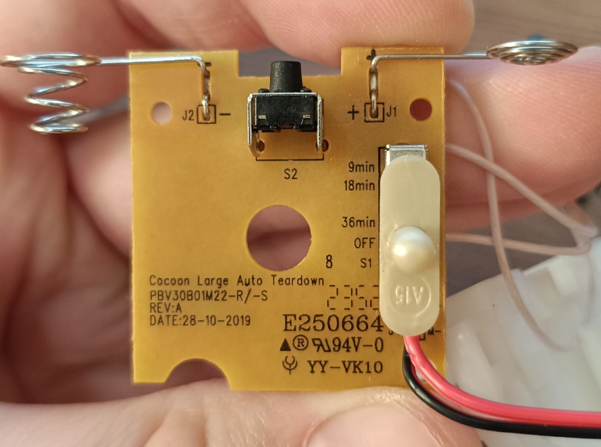

**English** | [Русский](README.ru.md)
# Glade Auto-Spray Device Mod

[](LICENSE)


A hardware modification of the **Glade Automatic Spray** air freshener based on the
**Digispark (ATtiny85)** board. It replaces the fixed factory spray timer with your
own programmable logic.


## Table of contents

- [Overview](#overview)
- [Bill of materials](#bill-of-materials)
- [Preparing the Digispark](#preparing-the-digispark-low-power-mod)
- [Wiring](#wiring)
- [Firmware](#firmware)
- [Power notes](#power-notes)
- [Disclaimer](#disclaimer)
- [Credits](#credits)
- [License](#license)

## Overview

The stock Glade Automatic Spray activates every **9, 18 or 36 minutes**. These
intervals are hard-coded and cannot be changed. This mod puts an ATtiny85 in charge,
so you can implement any activation logic you want: arbitrary intervals, night
pause, randomized timing, and so on.

- **Custom schedule** — any spray interval and logic, defined in your own firmware.
- **Battery-friendly** — runs from the device's own 2 × AA cells (~3 V); the
  low-power tweaks below keep consumption minimal.
- **Cheap and simple** — one Digispark, one capacitor and a few wires.
- **Fully offline** — no Wi-Fi, no cloud, no app required.

The entire modification is based on a built-in behavior of the stock Glade
controller's firmware: **the device sprays immediately whenever the mode is
changed from "Off" to any other mode (9, 18 or 36 minutes)**. The ATtiny85 merely
emulates this transition electronically — the stock controller, motor driver and
mechanics remain untouched.

The Digispark is installed inside the device, powered from its battery compartment,
and connected to the original PCB with two signal lines (`P0` / `P1`). A bulk
capacitor across the supply rails keeps the ATtiny85 from browning out while the
spray motor runs.

## Bill of materials

| Item | Qty | Notes |
|------|:---:|-------|
| Glade Automatic Spray device | 1 | Donor device |
| Digispark board (ATtiny85) | 1 | Any common clone works |
| Electrolytic capacitor | 1 | 470–1000 µF, ≥ 6.3 V (suggested) — buffers motor current spikes |
| Hookup wire | ~6 | Thin and flexible, e.g. AWG 26–30 |
| Soldering iron, side cutters, knife | — | For wiring and the low-power mod |

## Preparing the Digispark (low-power mod)

The Digispark is designed for USB power, not batteries. To avoid wasting battery
capacity, strip it down before installation:

1. **Disable the power LED** — cut the trace leading to it on the board (or simply
   desolder the LED).
2. **Remove the 5 V voltage regulator** and its supporting components — the board
   will be powered directly from the device's batteries through the `5V` pin.
3. **Desolder the user LED on `P1` and its series resistor** (the one used by the
   *Blink* example). Besides saving power, this removes the LED load from `P1`,
   which is used as a signal line in this mod.

| | |
|:---:|:---:|
|  |  |

## Wiring

Solder the wires to the numbered pads on the Glade device PCB:



> [!NOTE]
> The stock controller's **"9 Min"** input must be **disconnected from the mode
> switch** — cut the trace between the switch and the chip pin. The Digispark's
> `P0` drives this input directly. See the comments in
> [`firmware.ino`](firmware.ino) for details.

| Glade PCB pad | Connect to | Notes |
|:---:|:---:|-------|
| **1** | Digispark **P1** | "Off" mode input of the stock controller |
| **2** | Digispark **GND** | Ground |
| **3** | Digispark **5V** | Battery `+` (~3 V), regulator bypassed |
| **4** | Digispark **P0** | "9 Min" mode input (disconnected from the switch) |
| **3 + 5** | Capacitor **C1** | `+` to pad 3, `−` to pad 5 |

### Connection diagram

```text
      Glade device PCB                            Digispark (ATtiny85)
    +------------------------+                  +--------------------+
    |                        |                  |                    |
    |  Pad 1  o--------------+------------------+------o  P1         |
    |                        |                  |                    |
    |  Pad 2  o--------------+------------------+------o  GND        |
    |                        |                  |                    |
    |  Pad 3  o---+----------+------------------+------o  5V         |
    |   (V+)      |          |                  |                    |
    |            === (+)     |                  |                    |
    |        C1  --- (-)     |                  |                    |
    |             |          |                  |                    |
    |  Pad 5  o---+          |                  |                    |
    |   (V-)                 |                  |                    |
    |  Pad 4  o--------------+------------------+------o  P0         |
    |                        |                  |                    |
    +------------------------+                  +--------------------+
```

**C1** is an electrolytic capacitor connected between pads **3** and **5**. It
stabilizes the supply rail while the motor runs — without it, the voltage dip can
reset the Digispark.

> [!WARNING]
> Mind the polarity of the electrolytic capacitor: `+` to pad 3, `−` to pad 5.
> A reversed electrolytic capacitor can leak or burst.

Actual wiring:


## Firmware

The sketch is located in [`firmware.ino`](firmware.ino).

### How it works

> [!NOTE]
> **Key principle:** the stock Glade controller's firmware triggers a spray
> immediately whenever the operating mode is changed from **"Off"** to any other
> mode (**9, 18 or 36 minutes**). The entire logic of this modification is built
> around this behavior.

The firmware keeps the stock Glade controller and emulates its mode switch:

- `P0` pulls the controller's **"9 Min"** input to GND (the chip's pin is
  disconnected from the mode switch).
- `P1` pulls the controller's **"Off"** input to GND.
- Every 6 minutes (`resetTime`) the "9 Min" line is briefly released and
  re-asserted — this resets the stock 9-minute timer, so the device never
  sprays on its own.
- Every 2.5 hours (`pauseTime`) the firmware switches "Off" → "9 Min", which
  makes the device spray once. The manual boost button keeps working as usual.
- Between cycles the ATtiny85 sleeps in `SLEEP_MODE_PWR_DOWN`, waking up every
  8 seconds via the watchdog; the ADC is disabled.

Timing is configured at the top of `firmware.ino`:

| Constant | Default | Meaning |
|----------|---------|---------|
| `pauseTime` | `9000` s (2.5 h) | Interval between sprays |
| `resetTime` | `360` s (6 min) | Stock timer reset period — keep it below 9 minutes |
| `workTime` | `16` s | Pause after a spray before the timing cycle restarts |

### Flashing

> [!IMPORTANT]
> **Before connecting the board to USB**, set the air freshener's mode switch to
> the **"Off"** position and **remove the batteries** (at least one of the two).
> The Digispark shares its `5V` rail with the device, so the freshener must be
> completely unpowered while the board is being flashed from USB.

1. Install the **Arduino IDE** and add
   `https://raw.githubusercontent.com/ArminJo/DigistumpArduino/master/package_digistump_index.json` to
   *File → Preferences → Additional Boards Manager URLs*.
2. Install **Digistump AVR Boards** via the Boards Manager and select
   **Digispark**.
3. Open `firmware.ino`, press *Upload*, then plug the board into a USB port —
   the Micronucleus bootloader waits a few seconds after power-up.
4. After flashing, disconnect USB, insert the batteries back and set the mode
   switch to **"9 Min"** — in this position the device powers the Digispark and
   the firmware takes over.

## Power notes

- The board is powered with ~3 V from the batteries through the `5V` pin, so the
  onboard regulator is bypassed — that is why it should be removed.
- 16.5 MHz at ~3 V is outside the ATtiny85's official spec. For reliability and
  lower consumption, consider running the clock at 8 MHz or 1 MHz.
- For maximum battery life, sleep in `POWER_DOWN` mode between sprays, wake up via
  the watchdog timer, and disable unused peripherals (ADC, brown-out detector).
- Keep C1 close to the supply pads — it absorbs the motor's inrush current.

## Disclaimer

This modification is performed at your own risk and voids the device warranty.
Remove the batteries and the spray can before soldering, and double-check all
connections and capacitor polarity before powering the device up.

## Credits

Sources of inspiration:

- [gemunet/custom-glade-automatic-air-freshener](https://github.com/gemunet/custom-glade-automatic-air-freshener) — detailed reverse engineering of the stock Glade PCB
- [alex-omk/zb_airWick](https://github.com/alex-omk/zb_airWick) — Zigbee Air Wick mod
- [samuelcarreira/glade-air-freshener-wifi-mod](https://github.com/samuelcarreira/glade-air-freshener-wifi-mod) — ESP8266 Wi-Fi Glade mod
- [floitsch/airwick](https://github.com/floitsch/airwick) — Air Wick hack

## License

Released under the [MIT License](LICENSE).