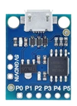
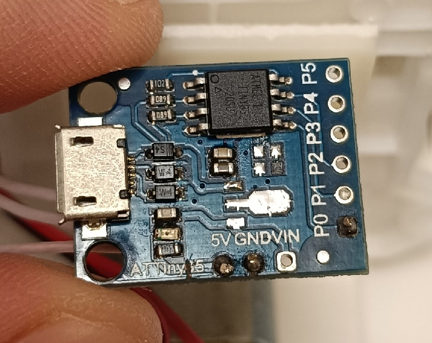
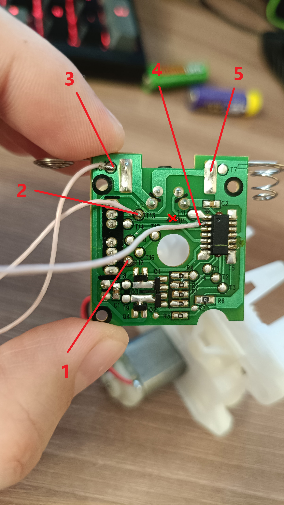

# Glade Auto-Spray Device Mod
A modification for the Glade auto-spray device based on the Digispark board.

The Glade Automatic Air Freshener is an electronic product that automatically activates an air spray every 9, 18, or 36 minutes. These time intervals are fixed and cannot be changed. This hack allows you to create your own logic and set any activation time you want.

All you'll need for this are a Digispark board (ATTiny85), some wires, a soldering iron, and some tools.

For maximum energy savings, you should disable the power LED (by cutting the trace leading to it on the circuit board) and remove the voltage regulator components and the blinking LED (blink example) along with its resistor.

Glade device PCB

Digispark connection sheme

1 - to Digispark P1
2 - to Digispark GND
3 - Digispark 5V
4 - to Digispark P0
3, 5 - to the electrolytic capacitor to stabilize the Digispark's operation while the engine is running

Sources of inspiration:
https://github.com/gemunet/custom-glade-automatic-air-freshener
https://github.com/alex-omk/zb_airWick
https://github.com/samuelcarreira/glade-air-freshener-wifi-mod
https://github.com/floitsch/airwick
