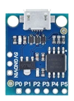
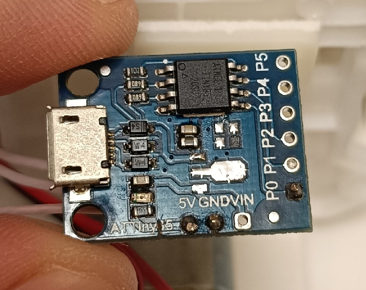
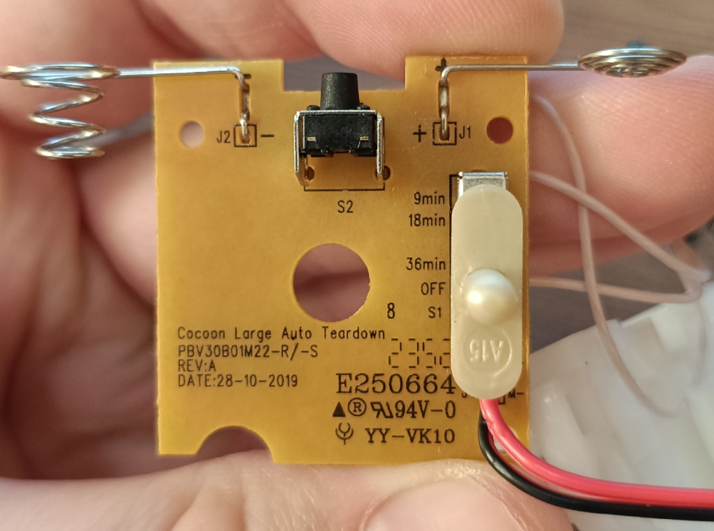
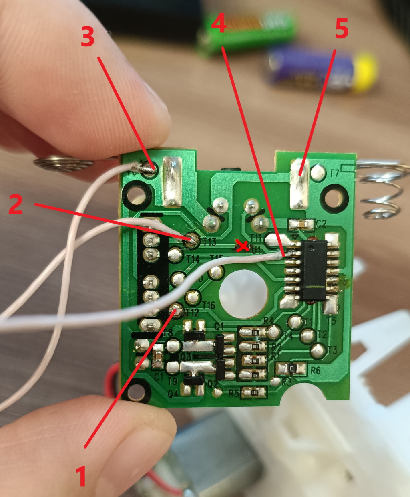

[English](README.md) | **Русский**

# Модификация автоматического освежителя Glade

[](LICENSE)


Аппаратная модификация автоматического освежителя воздуха **Glade Automatic Spray**
на базе платы **Digispark (ATtiny85)**. Заменяет фиксированный заводской таймер
распыления вашей собственной программируемой логикой.


## Содержание

- [Обзор](#обзор)
- [Необходимые компоненты](#необходимые-компоненты)
- [Подготовка Digispark](#подготовка-digispark-энергосберегающая-доработка)
- [Подключение](#подключение)
- [Прошивка](#прошивка)
- [Замечания по питанию](#замечания-по-питанию)
- [Отказ от ответственности](#отказ-от-ответственности)
- [Источники вдохновения](#источники-вдохновения)
- [Лицензия](#лицензия)

## Обзор

Штатный Glade Automatic Spray срабатывает каждые **9, 18 или 36 минут**. Эти
интервалы зашиты в устройство и не меняются. Модификация передаёт управление
ATtiny85, поэтому логику срабатываний можно задать любую: произвольные интервалы,
пауза на ночь, случайные срабатывания и так далее.

- **Свой график** — любые интервалы и логика, заданные в вашей прошивке.
- **Бережёт батарейки** — питание от штатных 2 × AA (~3 В); энергосберегающие
  доработки ниже сводят потребление к минимуму.
- **Дёшево и просто** — один Digispark, конденсатор и несколько проводов.
- **Полностью офлайн** — без Wi-Fi, облака и приложений.

Вся модификация построена на особенности базовой прошивки штатного контроллера
Glade: **устройство делает распыление сразу при смене режима с «Off» (выключено)
на любой другой (9, 18 или 36 минут)**. ATtiny85 лишь эмулирует этот переход
электронно — штатный контроллер, драйвер мотора и механика остаются нетронутыми.

Digispark устанавливается внутрь устройства, питается из батарейного отсека и
соединяется со штатной платой двумя сигнальными линиями (`P0` / `P1`). Конденсатор
по шинам питания не даёт ATtiny85 перезагружаться во время работы мотора.

## Необходимые компоненты

| Компонент | Кол-во | Примечания |
|-----------|:---:|------------|
| Освежитель Glade Automatic Spray | 1 | Устройство-донор |
| Плата Digispark (ATtiny85) | 1 | Подойдёт любой распространённый клон |
| Электролитический конденсатор | 1 | 470–1000 мкФ, ≥ 6,3 В (рекомендация) — сглаживает броски тока мотора |
| Монтажный провод | ~6 | Тонкий и гибкий, например AWG 26–30 |
| Паяльник, бокорезы, нож | — | Для монтажа и энергосберегающей доработки |

## Подготовка Digispark (энергосберегающая доработка)

Digispark рассчитан на питание от USB, а не от батареек. Чтобы не расходовать
ёмкость батарей впустую, доработайте плату перед установкой:

1. **Отключите светодиод питания** — перережьте ведущую к нему дорожку на плате
   (или просто выпаяйте светодиод).
2. **Удалите стабилизатор 5 В** и его обвязку — плата будет питаться напрямую от
   батареек устройства через вывод `5V`.
3. **Выпаяйте пользовательский светодиод на `P1` и его резистор** (тот, что мигает
   в примере *Blink*). Помимо экономии энергии это снимает нагрузку с вывода `P1`,
   который используется в этой модификации как сигнальная линия.

| | |
|:---:|:---:|
|  |  |

## Подключение

Припаяйте провода к пронумерованным точкам на плате устройства Glade:



> [!NOTE]
> Вход **«9 Min»** штатного контроллера необходимо **отсоединить от переключателя
> режимов** — перережьте дорожку между переключателем и выводом микросхемы. Этим
> входом напрямую управляет `P0` платы Digispark. Подробности — в комментариях к
> [`firmware.ino`](firmware.ino).

| Точка платы Glade | Куда подключить | Примечания |
|:---:|:---:|------------|
| **1** | Digispark **P1** | Вход режима «Off» штатного контроллера |
| **2** | Digispark **GND** | Земля |
| **3** | Digispark **5V** | Плюс батареек (~3 В), в обход стабилизатора |
| **4** | Digispark **P0** | Вход режима «9 Min» (отсоединён от переключателя) |
| **3 + 5** | Конденсатор **C1** | «+» к точке 3, «−» к точке 5 |

### Схема соединений

```text
      Плата Glade                                 Digispark (ATtiny85)
    +------------------------+                  +--------------------+
    |                        |                  |                    |
    |  Точка 1 o-------------+------------------+------o  P1         |
    |                        |                  |                    |
    |  Точка 2 o-------------+------------------+------o  GND        |
    |                        |                  |                    |
    |  Точка 3 o---+---------+------------------+------o  5V         |
    |   (V+)       |         |                  |                    |
    |             === (+)    |                  |                    |
    |         C1  --- (-)    |                  |                    |
    |              |         |                  |                    |
    |  Точка 5 o---+         |                  |                    |
    |   (V-)                 |                  |                    |
    |  Точка 4 o-------------+------------------+------o  P0         |
    |                        |                  |                    |
    +------------------------+                  +--------------------+
```

**C1** — электролитический конденсатор между точками **3** и **5**. Он стабилизирует
шину питания во время работы мотора — без него просадка напряжения может
перезагрузить Digispark.

> [!WARNING]
> Соблюдайте полярность электролитического конденсатора: «+» к точке 3, «−» к
> точке 5. Конденсатор с перепутанной полярностью может потечь или взорваться.

Фактический монтаж:



## Прошивка

Скетч находится в файле [`firmware.ino`](firmware.ino).

### Как это работает

> [!NOTE]
> **Ключевой принцип:** базовая прошивка штатного контроллера Glade запускает
> распыление сразу при смене режима с **«Off» (выключено)** на любой другой
> (**9, 18 или 36 минут**). На этой особенности построена вся логика модификации.

Прошивка сохраняет штатный контроллер Glade и эмулирует его переключатель режимов:

- `P0` притягивает к земле вход **«9 Min»** контроллера (вывод микросхемы
  отсоединён от переключателя).
- `P1` притягивает к земле вход **«Off»**.
- Каждые 6 минут (`resetTime`) линия «9 Min» ненадолго отпускается и снова
  прижимается к земле — это сбрасывает штатный 9-минутный таймер, поэтому само по
  себе устройство никогда не распыляет.
- Каждые 2,5 часа (`pauseTime`) прошивка переключает «Off» → «9 Min», и устройство
  делает одно распыление. Кнопка ручного распыления продолжает работать как обычно.
- Между циклами ATtiny85 спит в режиме `SLEEP_MODE_PWR_DOWN`, просыпаясь каждые
  8 секунд по watchdog; АЦП отключён.

Тайминги настраиваются в начале файла `firmware.ino`:

| Константа | По умолчанию | Назначение |
|-----------|--------------|------------|
| `pauseTime` | `9000` с (2,5 ч) | Интервал между распылениями |
| `resetTime` | `360` с (6 мин) | Период сброса штатного таймера — держите меньше 9 минут |
| `workTime` | `16` с | Пауза после распыления перед перезапуском цикла |

### Порядок прошивки

> [!IMPORTANT]
> **Перед подключением платы к USB** переведите переключатель освежителя в
> положение **«Off» (выключено)** и **выньте батарейки** (достаточно одной из
> двух). Digispark делит шину `5V` с устройством, поэтому на время прошивки от
> USB освежитель должен быть полностью обесточен.

1. Установите **Arduino IDE** и добавьте
   `https://raw.githubusercontent.com/ArminJo/DigistumpArduino/master/package_digistump_index.json` в
   *File → Preferences → Additional Boards Manager URLs*.
2. Установите пакет **Digistump AVR Boards** через менеджер плат и выберите
   **Digispark**.
3. Откройте `firmware.ino`, нажмите *Upload*, затем вставьте плату в USB-порт —
   загрузчик Micronucleus ждёт несколько секунд после подачи питания.
4. После прошивки отключите USB, верните батарейки и переведите переключатель в
   положение **«9 Min»** — в этом положении устройство подаёт питание на Digispark,
   и прошивка берёт управление на себя.

## Замечания по питанию

- Плата питается ~3 В от батареек через вывод `5V` в обход стабилизатора — именно
  поэтому его нужно удалить.
- 16,5 МГц при ~3 В — вне официальных характеристик ATtiny85. Для надёжности и
  меньшего потребления рассмотрите частоту 8 МГц или 1 МГц.
- Для максимального времени работы от батареек спите в режиме `POWER_DOWN` между
  распылениями, просыпайтесь по watchdog и отключайте неиспользуемую периферию
  (АЦП, детектор просадки питания — BOD).
- Размещайте C1 ближе к точкам питания — он гасит пусковой ток мотора.

## Отказ от ответственности

Модификация выполняется на ваш страх и риск и лишает устройство гарантии. Перед
пайкой выньте батарейки и баллончик, а перед включением перепроверьте все
соединения и полярность конденсатора.

## Источники вдохновения

- [gemunet/custom-glade-automatic-air-freshener](https://github.com/gemunet/custom-glade-automatic-air-freshener) — подробный реверс-инжиниринг штатной платы Glade
- [alex-omk/zb_airWick](https://github.com/alex-omk/zb_airWick) — Zigbee-модификация Air Wick
- [samuelcarreira/glade-air-freshener-wifi-mod](https://github.com/samuelcarreira/glade-air-freshener-wifi-mod) — Wi-Fi-модификация Glade на ESP8266
- [floitsch/airwick](https://github.com/floitsch/airwick) — хак Air Wick

## Лицензия

Распространяется под [лицензией MIT](LICENSE).